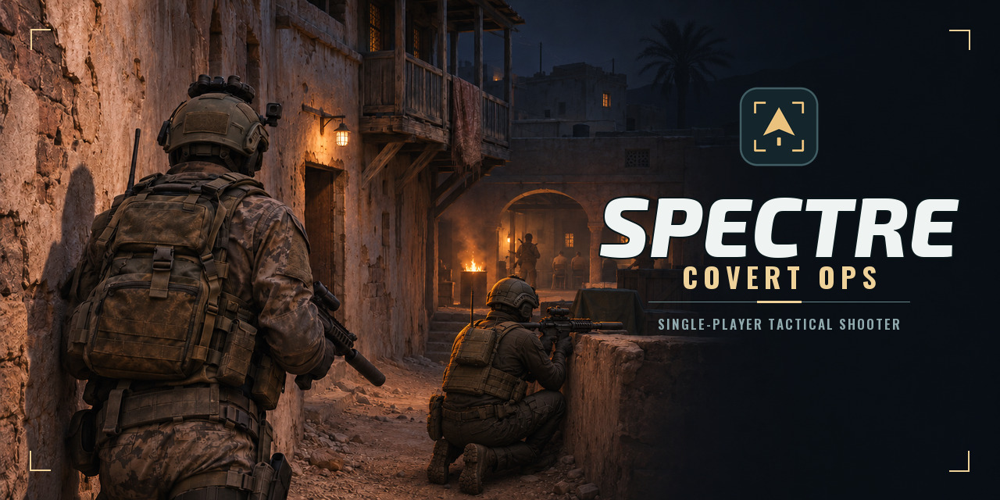

# SPECTRE: Covert Ops

**[Download v0.10 for Windows as one ZIP on itch.io](https://spectrecovertops.itch.io/spectre-covert-ops#download)**

SPECTRE: Covert Ops is a single-player tactical shooter built in Unreal Engine. Play as Spectre alongside Rook, your AI squadmate, across four missions: Frostfire, Blizzard, Desert Glory, and Death Trap. Infiltrate guarded sites, recover evidence, sabotage a supply cache, or rescue hostages, then signal a helicopter for extraction.

## Install on Windows

1. Download the single Windows ZIP from [itch.io](https://spectrecovertops.itch.io/spectre-covert-ops#download).
2. Choose **Extract All**. The ZIP already bundles the installer and all three `.bin` files. Keep them together in the extracted folder.
3. Run `SPECTRE-Covert-Ops-0.10-Win64-Setup.exe`. After installation, launch **SPECTRE - Covert Ops** from the Start menu.

The [GitHub v0.10 release](https://github.com/ATritle/Spectre-Covert-Ops/releases/tag/v0.10) has the release notes and the split installer as an alternate download.

## Command your squadmate

Press **Tab** by default to open the squad map and issue orders to Rook.

- **Follow** — have Rook stay with you.
- **Hold** — have Rook stay at his current position.
- **Move To** — click a reachable position on the map to send him there.
- **Follow Route** — hold the left mouse button to draw a path on the map. Release to send him along it.
- **Watch Sector** — after issuing Hold or placing a Move To marker, click where Rook should look or drag an arrow from the marker.

Set his rules of engagement from the same panel with **Hold Fire**, **Return Fire**, or **Engage**. Press **Tab** again to return to gameplay.
